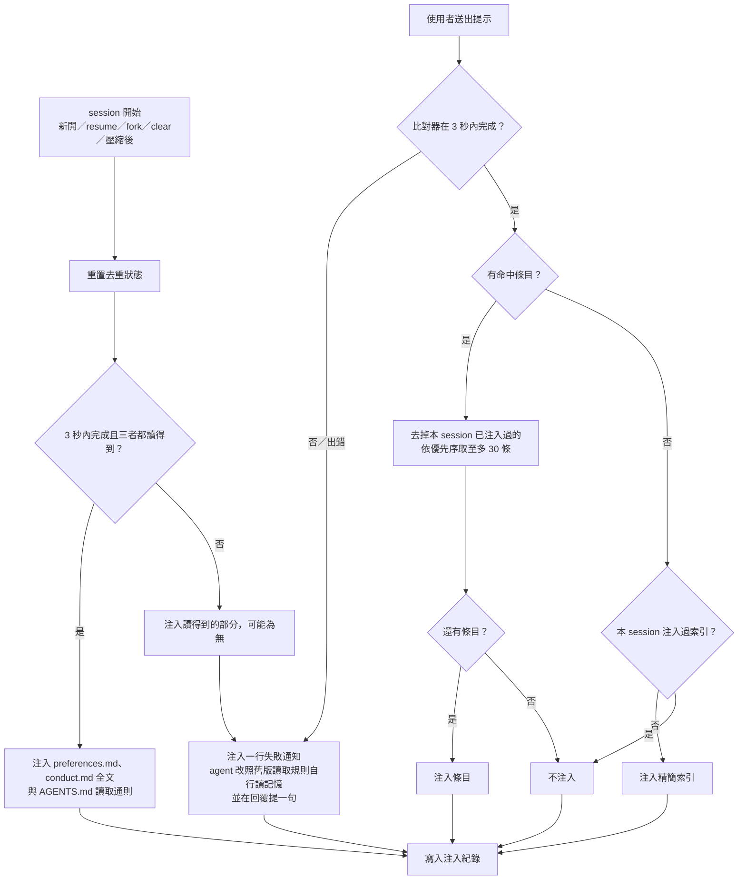

# 墨嵐記憶自動注入

## 背景與動機

墨嵐記憶模組是跨專案、跨 agent 共用的持久記憶庫，位於 `~/70_Memory/`。記憶以 markdown 檔儲存，依 `preferences.md`、`conduct.md`、`profile.md`、`topics/`、`areas/`、`people/`、`history/`、`reports/` 分類；每條事實標上來源標籤 `[stated]`、`[inferred]` 或 `[ref]`。讀寫規則寫在同目錄的 `AGENTS.md`，各 agent 的全域指示要求它在任務開始時讀取。

現行做法下，讀什麼、何時讀全由 agent 自行判斷：先讀 `AGENTS.md`，再掃各檔的 description 挑相關的讀。實際使用中普遍出現兩種失敗：

- **沒讀**：使用者只給簡短提示時，agent 不覺得需要查記憶，直接行動，方向錯誤，使用者得再提醒「記憶裡有」。
- **讀太晚**：記憶裡有相關規範，agent 卻在做完之後才發現。

另外，記憶的寫入標準不夠清楚，各 agent 判斷不一：不少 `areas/` 檔大半是 repo 內規格書的摘要；同一個事實在不同檔講法不一致；來源標籤標錯。結果是記憶沒有讓 agent 的表現明顯改進。

本規格把讀取從「agent 自律」改成「送出提示時自動比對並注入相關記憶」，同時釐清寫入標準，並整理既有記憶。

## 目標與非目標

**目標**

- 使用者送出提示時，相關記憶條目已在 agent 的 context 裡，不依賴 agent 主動去讀。
- 寫入標準明確到各 agent 對同一件事的寫法一致，每條記憶單獨拿出來也看得懂。
- 既有記憶整理成符合新標準的內容。

**非目標**

- 包成 MCP server。MCP 只能讓機械規則一致，解決不了讀取時機與語意判斷，暫緩；之後可作為沒有 hook 的介面的補位入口，與 hook 放在同一個專案。
- 用 embedding 或本地 AI 做語意比對。太吃效能。
- 第一版接 Claude Code 以外的 agent。
- Claude 桌面 app 一般對話的自動注入。該介面沒有送出提示時的 hook。
- 其他裝置的安裝與路徑差異。
- 依 agent 限制可注入的個人資訊範圍。

## 已定案的前提

- 注入靠 agent 的 hook 機制在「session 開始時」與「送出提示時」觸發，第一版只接 Claude Code。
- 比對器設計成跨 agent 共用：比對邏輯只有一份，各 agent 只需一層薄的 hook 接上它。已查到 Codex、Copilot、pi、Antigravity 都有對應的提示送出事件，供之後擴充。
- 記憶儲存維持 `70_Memory/` 內的 markdown 檔，使用者繼續用 Obsidian 直接閱讀與手改。
- 比對器程式與本規格書放在新 repo `~/github/ink-mist-memory`。

## 範圍

1. 比對器：依當下工作目錄與提示內容，找出相關記憶條目並產出要注入的內容。
2. Claude Code 的 hook 設定：session 開始時、送出提示時各接一次。
3. 注入紀錄。
4. `AGENTS.md` 改版：廢除舊讀取規則、加入讀取通則與新寫入標準、任務類型標題清單與好壞範例；舊讀取規則另存一份。
5. 各 agent 全域指示改版：`use_with_agent.md` 拆成 `use_with_agent.claude-code.md` 與 `use_with_agent.others.md` 兩份片段後刪除原檔，並套用到各 agent 的全域指示；Claude 桌面 app 的全域指示是介面設定，由使用者手動貼上並確認。
6. 既有記憶一次整理。
7. 驗收測試組。

**實施順序**：條目級注入依賴整理後的條目格式與任務類型標題，因此第 4、6 項先以 diff 形式準備並經使用者審過，期間不動正式記憶庫。審查期間正式庫可能仍被各 agent 寫入，切換前以最新的正式庫重新合併 diff，依 AGENTS.md §5 的 `version` 比對處理。審過後，以下同時切換，避免出現讀取規則已搬走、注入卻還沒上線的空窗：

- 套用第 4、6 項到正式記憶庫
- 上線 Claude Code 的 hook
- 套用第 5 項所有 agent 的全域指示

切換前備份正式記憶庫與各 agent 的全域指示。切換後若 hook 造成工作受阻，還原備份並移除 hook；只是效果不佳則依上線後觀察的規則修正，不回滾。

## 詳細規格

### 整體流程

### Session 開始

- 以下事件都算 session 開始：新開 session、resume、fork、clear、context 壓縮後。
- session 開始時重置去重狀態，並以全文注入 `preferences.md`、`conduct.md` 與 `AGENTS.md` 的「讀取通則」一節。三者不參與條目比對，也不計入 30 條上限。
- 必載檔不加任務類型標題，內容也不搬出；任務類型清單只參考它們歸納類型。
- 「讀取通則」告訴 agent 如何使用注入的記憶，至少涵蓋：
  - 回覆不提「根據記憶」或檔案路徑，失敗通知那一句除外。
  - `[stated]` 直接採信；`[inferred]` 當假設，可引導方向或提問，不可當事實轉述。
  - `history/`、`reports/` 不會被注入，使用者問起過去怎麼處理某事時自行查閱。
  - 收到精簡索引時，依描述判斷是否需要自行開檔。
  - 記憶裡找不到答案時照常完成任務、自然地問，得到答案後補寫。
- session 開始同樣適用 3 秒上限與失敗處理：程式出錯、崩潰或逾時時注入失敗通知；其中任一讀不到時，照常注入讀得到的部分，並附失敗通知。失敗通知與送出提示時的相同：agent 改照舊版讀取規則自行讀記憶，並在 session 開始後的第一則回覆提一句注入失敗。
- session 開始的程式崩潰而未完成去重狀態重置時，由同一 session 識別下一次送出提示的 hook 補做重置。

### 條目的定義

- 一條「條目」是記憶檔內文中帶來源標籤（`[stated]`、`[inferred]`、`[ref]`）的頂層列表項目，連同其下內嵌的所有子項目。子項目不單獨成為條目，因此父子永遠一起注入。上限計數、去重都以此為單位。
- 條目以「所屬檔案加內容」識別：session 中途內容被改過的條目視為新條目。

### 比對範圍

- 參與比對與精簡索引的是 `70_Memory/` 內，除下列以外的所有 `.md` 檔：
  - `AGENTS.md`、`use_with_agent.claude-code.md`、`use_with_agent.others.md`
  - 舊版讀取規則檔 `AGENTS.legacy-read.md`
  - `history/`、`reports/`
  - 注入紀錄資料夾 `_injection-log/`
  - 確定性規則系統的資料 `rules/`：由 `imr` 寫入，不是記憶
  - 必載檔 `preferences.md`、`conduct.md`：另由 session 開始注入
- `history/`、`reports/` 只在使用者問起過去時，由 agent 自行查閱。

### 比對訊號

送出提示時，比對器依三種訊號判斷條目是否相關，三者取聯集：

| 訊號 | 命中單位 | 命中條件 |
|---|---|---|
| 工作目錄 | 檔案 | 當下工作目錄等於某記憶檔宣告的 repo 路徑，或位於其下；以路徑段為界，`D:/github/foobar` 不算位於 `D:/github/foo` 之下 |
| 名稱與 aliases | 檔案 | 提示中出現某記憶檔 frontmatter 的 `name` 或任一 `aliases`；比對範圍內的所有檔案都可設 aliases，不再限 `areas/` 與 `people/`；資料夾型 `areas/` 的子檔除外 |
| 任務類型 | 段落 | 提示中出現某任務類型的關鍵字，各檔中位於該任務類型標題下的條目命中 |

**比對方式**：名稱、aliases 與任務類型關鍵字都採子字串比對，不分大小寫與全半形。

**資料夾型 `areas/`**：`areas/<name>/` 以資料夾名 `<name>` 加上 `_index.md` frontmatter 的 aliases 參與名稱比對，以 `_index.md` 的 `repos` 參與工作目錄比對；命中時視為命中資料夾內所有子檔。子檔不設 `aliases`、`repos`，設了也不參與比對，比對器在注入紀錄中提醒；子檔的 `name` 也不參與比對。

**repo 路徑欄位**：這是寫入端與比對器之間的介面，規則如下：

- 欄位名稱 `repos`，寫在有對應 repo 的 `areas/` 檔或資料夾 `_index.md` 的 frontmatter，為路徑列表，可列多個；沒有對應 repo 的事務或週期性職責不加這個欄位。
- 路徑統一用 `/`，比對時不分大小寫。
- 寫入該專案記憶的 agent 發現缺少時順手補上。

### 注入規則

- **粒度**：只注入條目本身，不注入 frontmatter、標題、段落前言等非條目文字。檔案層級命中時注入該檔全部條目，受上限截斷；任務類型命中時只注入該標題下的條目。
- **上限**：每次提示最多注入 30 條。超過時依下列順序取：
  1. 訊號優先序：工作目錄 > 名稱與 aliases > 任務類型。同一條目被多種訊號命中時，以其中最高的一級計。
  2. 同一級內依檔案 `version` 由新到舊；資料夾型用各子檔自己的 `version`；缺 `version` 的檔排最後；`version` 相同時依路徑字母序。
  3. 同一檔內依條目在檔案中的出現順序。
- **總長上限**：Claude Code 對單次 hook 注入的內容上限為 10,000 字元，超過時只會給 agent 前 2,000 字元預覽。因此每次注入的總長不超過 10,000 字元：送出提示時，超過就依上限規則的同一取捨順序少取條目，被少取的條目留待下次命中；session 開始的必載內容若超過，於注入紀錄提醒，由使用者精簡必載檔。
- **附出處**：每條注入時附上所屬檔案，讓 agent 需要時回原檔看上下文；agent 回覆使用者時不提「根據記憶」或檔案路徑。
- **不重複**：同一 session 已注入過的條目，之後再命中也不重複注入。有命中但全都注入過時，什麼都不注入。
- **去重狀態**：包含「已注入條目集合」與「精簡索引已注入」兩項，每次 session 開始事件都一起重置。去重狀態依 agent 提供的 session 識別（Claude Code 為 `session_id`）分開保存，並行的多個 session 互不影響；本規格所說的「同一 session」，指同一個 session 識別下兩次 session 開始事件之間。
- **沒命中**：完全沒命中任何條目時，注入精簡索引，即比對範圍內各記憶檔的名稱與一句話描述，資料夾型 `areas/` 以資料夾名與 `_index.md` 的描述列一項；同一 session 只注入一次。

### 失敗處理

- 比對器出錯、崩潰或超過 3 秒未完成，一律當失敗處理；提示照常送出，不被卡住。3 秒從 hook 被呼叫起算，含程式啟動與清除舊紀錄。比對器本身崩潰或逾時時，失敗通知與紀錄仍要能產生。
- 失敗時注入一行失敗通知：agent 改照舊版讀取規則自行讀記憶，並在回覆中提一句「這次記憶自動注入失敗」。這是「回覆不提記憶」的唯一例外。
- 寫入注入紀錄失敗時，不影響注入與提示送出。
- 局部錯誤不讓整次注入失敗：
  - 單一記憶檔 frontmatter 無法解析或缺 `name`：跳過該檔，在注入紀錄中提醒，其餘照常注入。缺 `version` 不跳過，依上限規則排最後。
  - `AGENTS.md` 的任務類型表格解析不了：停用任務類型訊號，在注入紀錄中提醒，其餘訊號照常。

### 注入紀錄

- 每次提示與每次 session 開始的注入結果都寫一筆紀錄，內容足以讓使用者分辨某次出錯是「比對器沒命中」還是「有注入但 agent 沒照做」：時間、工作目錄、提示、注入的條目與其命中訊號、或失敗原因。
- 紀錄放在 `70_Memory/_injection-log/`，保留 30 天；比對器每次執行時順手清除超過 30 天的紀錄。

### 任務類型標題清單

- 固定清單寫在 `AGENTS.md` 的一張表格，欄位為「任務類型」與「提示關鍵字」，關鍵字以頓號分隔。初稿從 `conduct.md`、`preferences.md`、`topics/dev-toolchain.md` 現有段落歸納，交使用者核准。比對器以這張表為唯一來源；表格缺少這兩欄的表頭，即視為解析不了。
- 任務類型標題寫成 `## 任務：<任務類型>`，以二級標題加「任務：」前綴與一般結構性標題區分，前綴比對不分全半形；`<任務類型>` 與表格「任務類型」欄比對時去除前後空白，不分大小寫與全半形；其下的巢狀標題，條目也算該任務類型。
- agent 寫入時只能從清單中挑標題。需要新類型時先向使用者提議；核准前，條目先寫在檔內最接近的既有標題下，核准後再搬。
- 帶任務類型前綴、但不在清單內的二級標題，比對器在注入紀錄中提醒。

### 寫入標準

`AGENTS.md` 的寫入規則改為：

- **範圍不收窄**：個人事實照記，包括興趣、硬體等。
- **明確排除兩類**：
  - 當下工作環境（repo、檔案、指令輸出）查得到的內容。repo 已有的一律不重寫，包括 repo 規格書裡已寫下的決策；也不逐條為 repo 內容建 `[ref]`，每個專案記憶檔只放指向 repo 文件入口（如規格書、任務卡目錄）的 `[ref]`；資料夾型專案放在描述專案整體的子檔，沒有就新建 `overview.md`，`_index.md` 仍只放子檔清單。AGENTS.md §4「主要用到的外部資料 → `[ref]`」改寫成此規則，repo 以外的外部資料照舊。
  - 會過期的狀態：沿用 AGENTS.md 既有定義，指會自然過期的一時狀態（如今天天氣、玩到哪一關），只記其持久形式；`areas/` 記錄的專案目前狀態不在此列。
- **repo 沒寫的決策與習慣留在記憶**：即使只跟單一專案有關，也寫在記憶，不放進 repo。
- **條目自足**：每條記憶單獨被注入時也要看得懂，不依賴同檔其他條目或段落前言。
- **附好壞範例**：`AGENTS.md` 為上述四條新規則各附好壞範例，降低各 agent 的判斷差異。
- 其餘既有規則照舊：分類、frontmatter（另加 `repos` 欄位，`aliases` 開放資料夾型 `areas/` 子檔以外的所有檔案使用）、來源標籤、只記現況、`history/` 與 `reports/` 的寫法、`version` 併發控制。

### 讀取規則改版

- `AGENTS.md` 現行 §0「每次必載」與 §6「讀取」的條文整段搬進舊版讀取規則檔：
  - §0 必載改由 session 開始的 hook 執行。
  - §6 中使用記憶的規則改寫進新版 `AGENTS.md` 的「讀取通則」一節，見〈Session 開始〉。
- 舊版讀取規則存成 `70_Memory/AGENTS.legacy-read.md`，`AGENTS.md` 開頭用一句話指向它。以下情況使用：
  - 比對器失敗時：失敗通知指向它。
  - 沒有接上 hook 的 agent：其全域指示指向它。
  - 使用者指名要用時。
- `AGENTS.md` §1 的結構樹與分類表更新：標示 `_injection-log/`、`AGENTS.legacy-read.md` 與兩份片段檔不是記憶。舊版讀取規則檔也註明掃描時排除它們。

### 各 agent 第一版的全域指示

Claude 桌面 app 內的 Claude Code session（Code 分頁）歸 Claude Code 那一列。

| agent／介面 | 全域指示 |
|---|---|
| Claude Code | 刪除「任務開始時必載並找相關記憶」；保留現行片段列的寫入時機（陳述持久事實、做出決策或偏好回饋、讀寫自帶記憶時），寫入前讀 `AGENTS.md`；讀取交給 hook |
| Claude 桌面 app 一般對話、Codex、Copilot、pi、Antigravity | 讀取改指向 `AGENTS.legacy-read.md`；寫入時機與寫入前讀 `AGENTS.md` 同 Claude Code |

### 既有記憶整理

改版時對全庫整理一次：

- repo 已有的內容刪除，改以 `[ref]` 指向；repo 沒寫的決策與習慣保留。
- 改寫成條目自足的格式，同類規範歸到任務類型標題下。
- 有對應 repo 的 `areas/` 檔與資料夾 `_index.md` 補上 `repos`。
- 修正來源標籤錯誤與跨檔講法不一致。

## 驗收條件

**觀察方式**：比對與注入行為以注入紀錄與 hook 輸出判定；agent 的回覆行為由使用者看回覆判定。

**AGENTS.md、全域指示與既有記憶整理**

- 整理結果以 diff 交使用者審，並附逐檔檢查清單，每檔逐項勾選：
  - 無 repo 重複內容
  - 條目自足
  - 所有事實都是帶來源標籤的頂層列表條目，沒有寫在表格、段落或無標籤父項下
  - 來源標籤正確
  - 有對應 repo 的 `areas/` 已補 `repos`，沒有的不加
  - 跨檔講法一致
  - 同類規範歸到任務類型標題下（不適用於必載檔）
- 新版 `AGENTS.md` 含讀取通則、任務類型標題清單，以及〈寫入標準〉四條新規則各自的好壞範例；舊版讀取規則檔存在且被 `AGENTS.md` 指向。
- 寫法一致：在兩份 `70_Memory/` 副本上，讓 Claude Code 與 Codex 依新版 `AGENTS.md` 各自寫入同一批事實，不碰正式記憶庫。事實清單由使用者提供約 10 條；寫入位置（檔案加所在二級標題）與來源標籤要全部一致，寫法由使用者判定。
- `use_with_agent.claude-code.md`、`use_with_agent.others.md` 存在，各 agent 實際的全域指示與〈各 agent 第一版的全域指示〉一表一致。
- 以上都經使用者確認才算通過。

**上線前：固定測試組**

- agent 搜尋 Claude Code 與 Codex 的本機 session 紀錄，不限時間，列出疑似使用者提醒過「記憶裡有」的候選對話，由使用者認定哪些算數，再還原當時的提示，目標 5 題；找到的不足 5 題時由使用者補題至 5 題。
- 每題預期命中的條目以整理後的記憶為準，由使用者確認後成為固定測試組。
- 某題因比對漏洞而命中不到時，不排除該題，改為補 alias 或任務類型標題讓它命中。
- 測試環境：上線前測試在已套用第 4、6 項 diff 的 `70_Memory/` 副本上跑，比對器的記憶庫路徑可設定；為了讓題目命中而補的 alias 或標題一併併入 diff。
- 送出條件：每題在新 session、對應的工作目錄，作為第一個提示送出。
- 通過標準：
  - 每題的注入內容包含全部預期條目。注入內容指 session 開始的注入加上第一個提示的注入。
  - 每題跑 3 次，3 次中 agent 的第一個動作（工具呼叫或回覆，取先出現者）都依循預期條目，由使用者判定。

**個別情境**

| 情境 | 應該看到 |
|---|---|
| 新開、resume、clear 或 context 壓縮後 | 注入 `preferences.md`、`conduct.md` 全文與讀取通則；已注入條目與索引旗標都重置 |
| 提示含資料夾型 `areas/` 的資料夾名 | 注入該資料夾各子檔的條目 |
| 必載檔或讀取通則有任一讀取失敗 | 注入讀得到的部分與失敗通知 |
| session 開始時程式出錯、崩潰或逾時 | 注入失敗通知 |
| 在某專案 repo 內送出不含專案名的提示 | 注入該專案記憶檔的條目 |
| 在資料夾型 `areas/` 的 repo 內送出提示 | 注入該資料夾各子檔的條目 |
| 提示中出現某記憶檔的 alias，工作目錄無關 | 注入該檔的條目 |
| 工作目錄不在任何 `repos` 之下、提示不含任何名稱或 alias，但含任務類型關鍵字 | 只注入各檔中該任務類型標題下的條目 |
| 命中超過 30 條 | 只注入 30 條，取捨符合上限規則的三層順序 |
| 同 session 第二次命中同一條 | 不再注入 |
| 有命中但全都注入過 | 不注入任何內容 |
| 完全沒命中，且本 session 尚未注入過索引 | 注入精簡索引 |
| 完全沒命中，本 session 已注入過索引 | 不注入任何內容 |
| 提示含 `history/` 或 `reports/` 的檔名 | 不注入該檔條目；沒有其他命中時，照沒命中規則處理 |
| 工作目錄為 `D:/github/foobar`，某檔宣告 `D:/github/foo` | 該檔不因工作目錄命中 |
| 比對器出錯、崩潰或超過 3 秒 | 提示照常送出；hook 輸出含失敗通知 |
| agent 收到失敗通知 | agent 自行讀記憶，並在回覆提一句（使用者看回覆判定） |
| 注入紀錄寫入失敗 | 注入與提示送出不受影響 |
| 任何一次提示或 session 開始 | 注入紀錄中有對應的一筆（紀錄寫入失敗時除外） |
| 比對器執行時存在超過 30 天的紀錄 | 該紀錄被清除 |
| 帶任務類型前綴但不在清單內的標題 | 注入紀錄中有提醒 |
| 兩個 session 並行，A 已注入某條，B 新開 | B 照常注入該條；B 的開始不重置 A 的去重狀態 |
| 某記憶檔 frontmatter 無法解析或缺 `name` | 跳過該檔，注入紀錄中有提醒，其餘照常 |
| 某記憶檔缺 `version` | 照常參與，取捨時排最後 |
| 任務類型表格缺表頭 | 停用任務類型訊號，注入紀錄中有提醒，其餘訊號照常 |
| session 開始崩潰後，同一 session 送出提示 | 去重狀態已被補做重置 |
| session 中途某條目內容被改過，之後再命中 | 視為新條目注入 |
| 提示中的名稱與 alias 大小寫或全半形不同 | 照樣命中 |
| 條目位於任務類型標題下的巢狀標題裡 | 隨該任務類型命中 |
| 資料夾型 `areas/` 的子檔設了 aliases | 不參與比對，注入紀錄中有提醒 |
| 命中條目總長超過 10,000 字元 | 依取捨順序少取，注入總長不超過 10,000 字元 |

**上線後**

- 觀察 2 週，期間使用者在 Claude Code 中需要提醒 agent「記憶裡有」不超過 1 次。
- 由 agent 搜尋觀察期內的 Claude Code session 紀錄，列出疑似提醒的候選對話，由使用者認定後計數。
- 不通過時，檢討比對訊號與寫入格式並修正後，再觀察一輪。

## 考慮過但捨棄的方向

- **以 MCP server 作為主方案**：只能保證格式、併發等機械規則，讀取時機與語意判斷仍靠 agent，不解決核心問題。
- **只做寫入守門、讀取照舊**：不處理讀取失敗。
- **由本地 Ollama 判斷寫入位置與標籤**：本地模型判斷品質不可靠，且吃效能。
- **讀取完全交給 MCP 檢索**：與 hook 注入本質相同，併入本方案。
- **專案規範全搬回 repo 的 CLAUDE.md**：使用者不想把決策與習慣放進 repo，只有既定內容留 repo。
- **寫入標準收窄成「會改變 agent 行動」**：幾乎每條事實都可能影響某些任務的行動，篩不出東西。
- **embedding 語意比對**：需額外的本地 AI，太吃效能。
- **每條加任務類型 tag**：改用段落標題，少一道寫入判斷。
- **注入整份檔案原文**：連同前言、標題一起注入，大檔太佔 context；只給路徑則仍靠 agent 去讀。

## 已知限制與風險

- **Claude 桌面 app 與第一版未接的 agent 沒有自動注入**：只能靠指向舊版讀取規則的軟性指示。第一版接受這個落差。
- **其他 agent 的 hook 穩定度**：Codex 的 hook 仍屬 experimental，Antigravity 的 hook 只有第三方文件佐證。接受此風險，日後擴充時再驗證。
- **純文字比對會漏也會誤中**：沒用到名稱、alias 或標題詞彙的提示比對不到；常見詞或過短的 alias 因子字串比對會誤中。以 30 條的上限與優先序控制噪音。
- **大檔分批注入**：單一檔案條目超過 30 條時，第一次只注入前 30 條；同一 session 之後的提示若再命中，會因去重而注入下一批，直到注入完。第一個提示時靠後的條目還不在 context 中。
- **hook 入口本身跑不起來時沒有任何通知**：執行環境缺失、路徑錯誤或 hook 設定被刪時，agent 收不到注入也收不到失敗通知，回到「沒讀」的狀態。第一版接受，靠注入紀錄出現空窗來察覺。
- **Claude Code subagent 與非互動模式不涵蓋**：subagent 不經過送出提示的事件，全域指示改版後也不再要求讀記憶，因此拿不到記憶。第一版接受。

## 待決事項

無。

## 參考資料

- `~/70_Memory/AGENTS.md`：現行記憶系統規格。
- `~/70_Memory/use_with_agent.md`：貼進各 agent 全域指示的啟用片段。
- 各 agent 的提示送出事件：
  - Claude Code：`UserPromptSubmit`、`SessionStart`；hook 注入內容上限 10,000 字元。參見 [Claude Code hooks reference](https://code.claude.com/docs/en/hooks)。
  - Codex：`UserPromptSubmit`，experimental，需在 `config.toml` 開 `codex_hooks`。參見 [Codex CLI Hooks Deep Dive](https://codex.danielvaughan.com/2026/03/26/codex-cli-hooks-deep-dive)。
  - Copilot：`UserPromptSubmit`，與 VS Code 格式相容。參見 [GitHub Copilot CLI hooks reference](https://docs.github.com/en/copilot/reference/copilot-cli-reference/cli-hooks-reference)。
  - pi：extension 的 `before_agent_start`。參見 [pi Extension API](https://cdn.jsdelivr.net/npm/@josephakern/pi-memory@0.3.0/docs/research/02-pi-extension-api.md)。
  - Antigravity：`BeforeAgent`，第三方文件。參見 [A developer's guide to agent hooks in Antigravity CLI](https://medium.com/google-cloud/a-developers-guide-to-agent-hooks-in-antigravity-cli-4c1440febd11)。
